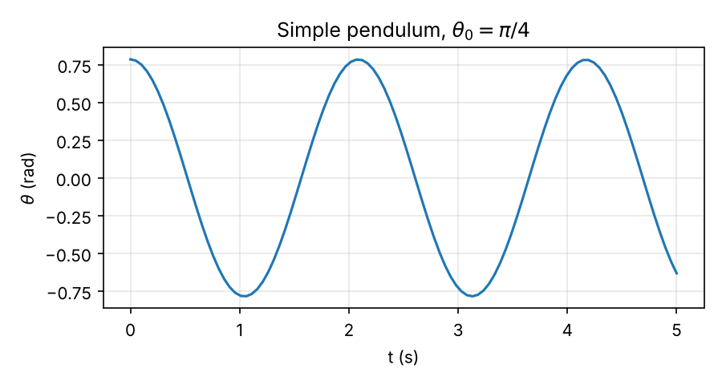

## Solving ODEs and Animating a Simple Pendulum {#sec-ode-pendulum}

Most equations of motion in this course cannot be solved by hand. In this assignment you will solve the equation of motion of a simple pendulum numerically in Python, plot the result, and turn it into an animation like the one below.



By the end you should be able to:

1. Rewrite a second-order equation of motion as a system of first-order ODEs.
2. Solve it with `solve_ivp` from SciPy and plot the solution.
3. Convert the solution into positions and animate it with Matplotlib.
4. Judge whether a numerical solution can be trusted.

::: {.callout-note title="Code you can run on this page"}
Cells with a **Run Code** button run Python directly in your browser, with nothing to install. Edit the code and run it as often as you like. The first run downloads Python and its packages, which can take up to a minute; after that, runs are quick.
:::

### What you need {#what-you-need}

- **Python 3** with three packages: `numpy` (arrays and math), `scipy` (the ODE solver) and `matplotlib` (plots and animations). Install them with
  ```bash
  pip install numpy scipy matplotlib
  ```
- **ffmpeg**, the program Matplotlib uses to save the animation as an `.mp4` video. On macOS install it with `brew install ffmpeg`; on Windows, download it from [ffmpeg.org](https://ffmpeg.org/download.html) and add it to your PATH. With Anaconda, `conda install -c conda-forge ffmpeg` works on any system.
- An editor such as VS Code, or a Jupyter notebook.

::: {.callout-tip title="No installation? Use Google Colab"}
[Google Colab](https://colab.research.google.com/) already has `numpy`, `scipy`, `matplotlib` and `ffmpeg`, and the saved `.mp4` appears in the Files panel on the left. In a notebook, an animation does not play with `plt.show()`. Display it with these two lines instead:

```python
from IPython.display import HTML
HTML(ani.to_jshtml())
```
:::

### Step 1: The equation of motion

In [Example: Nonlinear Pendulum](../particle_dynamics/cylindrical_polar_coordinates.qmd#example-nonlinear-pendulum) we found the equation of motion of a particle of mass $m$ on a massless string of length $\ell$:
\begin{align}
    \ddot{\theta} + \frac{g}{\ell}\sin(\theta) = 0,
\end{align}
where $\theta$ is measured from the downward vertical.

This equation is **nonlinear** because of $\sin(\theta)$, and it has no solution in terms of elementary functions. We need its solution $\theta(t)$ for given initial conditions $\theta(0) = \theta_0$ and $\dot{\theta}(0) = \dot{\theta}_0$. This is an *initial value problem*.

### Step 2: Rewrite it as a first-order system

Numerical ODE solvers work with systems of **first-order** equations, $\dot{\bf x} = {\bf f}(t, {\bf x})$. To bring our equation to this form, define the state
\begin{align}
    x_1 = \theta, \qquad x_2 = \dot{\theta}.
\end{align}
Differentiating each and using the equation of motion gives
\begin{align}
    \dot{x}_1 &= x_2, \\
    \dot{x}_2 &= -\frac{g}{\ell}\sin(x_1),
\end{align}
with initial conditions $x_1(0) = \theta_0$ and $x_2(0) = \dot{\theta}_0$.

::: {.callout-tip title="Think!"}
**Question:** How many first-order equations would you need for a double pendulum, which has two degrees of freedom?

::: {.callout-note title="Answer" collapse="true"}
Four. Each degree of freedom contributes a coordinate and its rate: $x_1 = \theta_1$, $x_2 = \theta_2$, $x_3 = \dot{\theta}_1$, $x_4 = \dot{\theta}_2$. In general, $n$ second-order equations become $2n$ first-order equations.
:::
:::

:::: {.content-visible when-format="html"}

#### Your turn: write the right-hand side

The solver needs a Python function `dxdt(t, x)` that takes the time `t` and the state `x = [x1, x2]` and returns $[\dot{x}_1, \dot{x}_2]$. Python counts from 0, so $x_1$ is `x[0]` and $x_2$ is `x[1]`.

Replace the blanks `______` using the system above, then press **Run Code**. The last line evaluates your function at $\theta = 0.5$ rad, $\dot{\theta} = 1.2$ rad/s so it can be checked.

```{pyodide}
#| exercise: ex_dxdt
#| setup: true
import numpy as np
g = 9.81
l = 1
```

```{pyodide}
#| exercise: ex_dxdt
def dxdt(t, x):
    xdot1 = ______
    xdot2 = ______
    return [xdot1, xdot2]

dxdt(0, [0.5, 1.2])
```

```{pyodide}
#| exercise: ex_dxdt
#| check: true
import numpy as np
g, l = 9.81, 1
expected = [1.2, -g/l*np.sin(0.5)]
try:
    got = [float(v) for v in result]
except Exception:
    got = None
if got is None or len(got) != 2:
    feedback = {"correct": False, "message": "Your function should return a list of two numbers: [xdot1, xdot2]."}
elif np.allclose(got, expected):
    feedback = {"correct": True, "message": "Correct! This is exactly the function the solver needs."}
elif np.allclose(got, expected[::-1]):
    feedback = {"correct": False, "message": "Close: you have swapped the two entries. The first entry is the rate of x1, which is x2."}
elif np.isclose(got[0], 1.2) and np.isclose(got[1], -g/l*0.5):
    feedback = {"correct": False, "message": "You used theta instead of sin(theta). The pendulum equation is nonlinear: use np.sin(x[0])."}
elif np.isclose(got[0], 1.2) and np.isclose(got[1], g/l*np.sin(0.5)):
    feedback = {"correct": False, "message": "Check the sign of xdot2. Gravity pulls the pendulum back toward theta = 0."}
elif np.isclose(got[0], 1.2):
    feedback = {"correct": False, "message": "xdot1 is right. Look again at the equation for xdot2."}
else:
    feedback = {"correct": False, "message": "Not yet. Remember that x[0] is theta and x[1] is the angular velocity."}
feedback
```

::: {.hint exercise="ex_dxdt"}
::: {.callout-note collapse="false"}
## Hint 1
The first equation of the system is $\dot{x}_1 = x_2$. In code, $x_2$ is `x[1]`.
:::
:::

::: {.hint exercise="ex_dxdt"}
::: {.callout-note collapse="false"}
## Hint 2
The second equation is $\dot{x}_2 = -\frac{g}{\ell}\sin(x_1)$. Use `np.sin` for the sine, and `g` and `l` are already defined.
:::
:::

::: {.solution exercise="ex_dxdt"}
::: {.callout-tip collapse="false"}
## Solution
```python
def dxdt(t, x):
    xdot1 = x[1]
    xdot2 = -g/l*np.sin(x[0])
    return [xdot1, xdot2]
```
:::
:::

::::

:::: {.content-visible unless-format="html"}
*This exercise is interactive: complete it in the online version of these notes.*
::::

### Step 3: Solve with `solve_ivp`

First, import the packages and set the parameters.

```python
import numpy as np
from scipy.integrate import solve_ivp
import matplotlib.pyplot as plt
import matplotlib.animation as animation

g = 9.81    # Gravitational acceleration in SI units
l = 1       # Length of pendulum chord in meters
```

Next, add the right-hand side ${\bf f}(t, {\bf x})$, the function `dxdt` you wrote above.

```python
# Define the ODE function
def dxdt(t, x):
    xdot1 = x[1]
    xdot2 = -g/l*np.sin(x[0])
    return [xdot1, xdot2]
```

Now choose the time interval and the initial conditions, and call the solver. Here the pendulum is released from rest at $\theta_0 = \pi/4$ (45°).

```python
# Define the time span and initial condition
t_span = (0, 5)          # Time interval: from 0 to 5 s
x0 = [np.pi/4, 0]        # theta(0) = pi/4, thetadot(0) = 0

# Solve the ODE
solution = solve_ivp(dxdt, t_span, x0, t_eval=np.linspace(0, 5, 100))

theta = solution.y[0]
thetadot = solution.y[1]
```

The arguments of `solve_ivp` are:

| Argument | Meaning |
| --- | --- |
| `dxdt` | The function ${\bf f}(t, {\bf x})$ |
| `t_span` | Start and end times |
| `x0` | Initial state $[\theta_0, \dot{\theta}_0]$ |
| `t_eval` | The times at which you want the solution stored (here 100 equally spaced times) |

The result `solution` holds the times in `solution.t` and the states in `solution.y`: row 0 is $\theta$, row 1 is $\dot{\theta}$. By default the solver uses `RK45`, a Runge–Kutta method that adjusts its own step size.

Plot $\theta(t)$ to look at the solution:

```python
plt.plot(solution.t, theta)
plt.xlabel("t (s)")
plt.ylabel("theta (rad)")
plt.show()
```

{width=70% fig-align="center"}

::: {.callout-tip title="Think!"}
**Question:** For small angles, $\sin(\theta) \approx \theta$ and the period is $T_0 = 2\pi\sqrt{\ell/g} \approx 2.01$ s. Read the period off the plot above. Is it the same?

::: {.callout-note title="Answer" collapse="true"}
The first maximum after release is at about $t = 2.09$ s, so the period is about $2.09$ s, roughly 4% longer than $T_0$. The period of the nonlinear pendulum grows with the amplitude. At $45^\circ$, $\sin(\theta)$ is already noticeably smaller than $\theta$, so the restoring torque is weaker than the linear model predicts.
:::
:::

:::: {.content-visible when-format="html"}

#### Try it in your browser

Here is everything from this step in one cell. Change the length `l` or the initial angle `theta0`, then press **Run Code** to see how the motion changes.

```{pyodide}
#| autorun: false
#| fig-width: 7
#| fig-height: 3.5
import numpy as np
from scipy.integrate import solve_ivp
import matplotlib.pyplot as plt

g = 9.81            # gravitational acceleration (m/s^2)
l = 1               # length of the pendulum (m)
theta0 = np.pi/4    # initial angle (rad)
thetadot0 = 0       # initial angular velocity (rad/s)

def dxdt(t, x):
    xdot1 = x[1]
    xdot2 = -g/l*np.sin(x[0])
    return [xdot1, xdot2]

solution = solve_ivp(dxdt, (0, 5), [theta0, thetadot0], t_eval=np.linspace(0, 5, 100))

plt.plot(solution.t, solution.y[0])
plt.xlabel("t (s)")
plt.ylabel("theta (rad)")
plt.grid(alpha=0.3)
plt.show()
```

::::

:::: {.content-visible unless-format="html"}
*An interactive version of this code is available in the online version of these notes.*
::::

### Step 4: From angle to position

To draw the pendulum we need the position of the mass. With the pivot at the origin, $x$ to the right and $y$ up:
\begin{align}
    x = \ell\sin(\theta), \qquad y = -\ell\cos(\theta).
\end{align}

```python
x = l*np.sin(theta)
y = -l*np.cos(theta)
```

`theta` is an array, so `x` and `y` are arrays too: one position for each of the 100 times.

### Step 5: Animate the pendulum {#step-5-animate-the-pendulum}

An animation is a figure whose contents are updated frame by frame. First, set up the figure with the pendulum in its initial position: a line for the string and a circle for the mass.

```python
# Set up the figure and axis
fig, ax = plt.subplots()          # creating figure and axes objects
ax.set_xlim([-1.2*l, 1.2*l])      # limits of x-axis
ax.set_ylim([-1.2*l, 0.2*l])      # limits of y-axis
ax.set_aspect('equal')

# Set axis labels and title
ax.set_xlabel("x")
ax.set_ylabel("y")
ax.set_title("Animating motion of pendulum")

# Drawing a line from the origin to the mass m.
# This line represents the chord of the pendulum.
line, = ax.plot([0, x[0]], [0, y[0]], color='black')
circle = plt.Circle((x[0], y[0]), 0.1, color='blue', fill=True)
ax.add_patch(circle)
```

::: {.callout-note title="Why `set_aspect('equal')`?"}
Without it, one unit on the $x$-axis and one unit on the $y$-axis can have different lengths on screen. The circle would look like an ellipse and the string would appear to stretch as it swings.
:::

Next, write an `update` function. Matplotlib calls it once per frame with the frame number, and it moves the line and the circle to that frame's position.

```python
# Update function for animation
def update(frame):
    line.set_xdata([0, x[frame]])
    line.set_ydata([0, y[frame]])
    circle.center = (x[frame], y[frame])
    return line, circle,
```

Finally, create the animation, save it as an `.mp4` video and show it.

```python
# Create animation
ani = animation.FuncAnimation(fig, update, frames=np.size(x), interval=50, blit=True)
ani.save('pendulum_animation.mp4', writer='ffmpeg', fps=20)

plt.show()
```

- `frames=np.size(x)` makes one frame per stored time (100 frames).
- `interval=50` shows each frame for 50 ms. Because the 100 stored times are 0.05 s apart, the animation plays in real time.
- `fps=20` sets the frame rate of the saved file, again 1/0.05 s.

::: {.callout-warning title="Error when saving?"}
If `ani.save` fails with a message like `MovieWriter ffmpeg unavailable`, Python cannot find ffmpeg. Install it (see [What you need](#what-you-need)) and restart your editor or terminal.
:::

### The complete script

::: {.callout-note title="Full code: animation_simple_pendulum.py" collapse="true"}
```python
# xdot1 = x2
# xdot2 = -g/l*sin(x1)

import numpy as np
from scipy.integrate import solve_ivp
import matplotlib.pyplot as plt
import matplotlib.animation as animation

g = 9.81    # Gravitational acceleration in SI units
l = 1       # Length of pendulum chord in meters

# Define the ODE function
def dxdt(t, x):
    xdot1 = x[1]
    xdot2 = -g/l*np.sin(x[0])
    return [xdot1, xdot2]

# Define the time span and initial condition
t_span = (0, 5)          # Time interval: from 0 to 5 s
x0 = [np.pi/4, 0]        # theta(0) = pi/4, thetadot(0) = 0

# Solve the ODE
solution = solve_ivp(dxdt, t_span, x0, t_eval=np.linspace(0, 5, 100))

theta = solution.y[0]
thetadot = solution.y[1]

x = l*np.sin(theta)
y = -l*np.cos(theta)

# Set up the figure and axis
fig, ax = plt.subplots()          # creating figure and axes objects
ax.set_xlim([-1.2*l, 1.2*l])      # limits of x-axis
ax.set_ylim([-1.2*l, 0.2*l])      # limits of y-axis
ax.set_aspect('equal')

# Set axis labels
ax.set_xlabel("x")
ax.set_ylabel("y")

# Set plot title
ax.set_title("Animating motion of pendulum")

# Drawing a line from the origin to the mass m.
# This line represents the chord of the pendulum.
line, = ax.plot([0, x[0]], [0, y[0]], color='black')
circle = plt.Circle((x[0], y[0]), 0.1, color='blue', fill=True)
ax.add_patch(circle)

# Update function for animation
def update(frame):
    line.set_xdata([0, x[frame]])
    line.set_ydata([0, y[frame]])
    circle.center = (x[frame], y[frame])
    return line, circle,

# Create animation
ani = animation.FuncAnimation(fig, update, frames=np.size(x), interval=50, blit=True)
ani.save('pendulum_animation.mp4', writer='ffmpeg', fps=20)

plt.show()
```
:::

### Video walkthrough

The two videos below go through the same procedure. Watch them if you want to see the code written and run step by step.





### Exercises

**1. Large swings.** Release the pendulum from rest at $\theta_0 = 170^\circ$ (remember to convert to radians with `np.radians(170)`) and solve over 10 s. Plot $\theta(t)$ and animate it. Does the motion make physical sense?

::: {.callout-note title="Hint" collapse="true"}
A pendulum released from rest cannot rise higher than where it started, so $\theta$ should stay between $-170^\circ$ and $170^\circ$. If your plot leaves that range, the problem is not the physics. Look at the optional arguments `rtol` and `atol` of `solve_ivp`, and see Exercise 2.
:::

**2. Can you trust the solver?** For the undamped pendulum, the energy per unit mass
\begin{align}
    e = \frac{1}{2}\ell^2\dot{\theta}^2 + g\ell\left(1-\cos(\theta)\right)
\end{align}
should stay constant. Solve for $\theta_0 = \pi/4$ over 60 s, compute $e$ at every stored time, and plot it. Then solve again with `rtol=1e-8, atol=1e-10` and compare. What does this tell you about the default settings?

**3. Linear versus nonlinear.** On the same axes, plot $\theta(t)$ from the nonlinear equation and from the linearized equation $\ddot{\theta} + \frac{g}{\ell}\theta = 0$, first for $\theta_0 = 5^\circ$ and then for $\theta_0 = 60^\circ$. When is the linear model good enough?

:::: {.content-visible when-format="html"}

You can work in the cell below. The nonlinear solution is already plotted; add the linear one.

```{pyodide}
#| autorun: false
#| fig-width: 7
#| fig-height: 3.5
import numpy as np
from scipy.integrate import solve_ivp
import matplotlib.pyplot as plt

g = 9.81
l = 1
theta0 = np.radians(5)
t_eval = np.linspace(0, 10, 500)

def nonlinear(t, x):
    return [x[1], -g/l*np.sin(x[0])]

# Write the linearized system here
def linear(t, x):
    return [x[1], 0]    # replace 0 with the linear term

sol_nl = solve_ivp(nonlinear, (0, 10), [theta0, 0], t_eval=t_eval, rtol=1e-8, atol=1e-10)
sol_l = solve_ivp(linear, (0, 10), [theta0, 0], t_eval=t_eval, rtol=1e-8, atol=1e-10)

plt.plot(sol_nl.t, np.degrees(sol_nl.y[0]), label="nonlinear")
plt.plot(sol_l.t, np.degrees(sol_l.y[0]), "--", label="linear")
plt.xlabel("t (s)")
plt.ylabel("theta (deg)")
plt.legend()
plt.show()
```

::::

:::: {.content-visible unless-format="html"}
*An interactive starter cell for this exercise is available in the online version of these notes.*
::::

**4. Add damping.** Air resistance adds a term to the equation of motion:
\begin{align}
    \ddot{\theta} + \frac{c}{m}\dot{\theta} + \frac{g}{\ell}\sin(\theta) = 0.
\end{align}
Rewrite it as a first-order system, change `dxdt` accordingly, and animate the motion for $c/m = 0.5$ s$^{-1}$. Plot the energy $e$ from Exercise 2. How does it change over time, and why?
